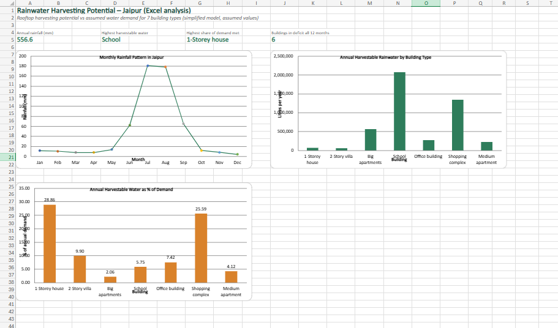

# Rainwater Harvesting Potential Analysis (Excel)

An Excel-based learning project that estimates how much rooftop rainwater different building types in Jaipur could harvest, and whether it could meet their monthly water demand.

> **Please note:** The roof areas and daily water consumption values are **assumed typical values** for learning purposes [add your source if you used one]. This is a simplified model, not a design for a real harvesting system.

## Dashboard preview

## Research question

Can rooftop rainwater harvesting meet the water demand of different building types in Jaipur throughout the year, or does it leave a supply-deficit gap?

## What is in this repo

| File | What it is |
| --- | --- |
| `Water_harvesting_dashboard.xlsx` | Full workbook: raw data, rainfall data, calculations, summary, findings and dashboard |
| `dashboard.png` | Screenshot of the dashboard |

## Workbook sheets

- **Raw_data**: 7 building types with occupants, roof area and daily, monthly and yearly water consumption
- **Rainfall monthly data**: Jaipur average monthly rainfall (mm). Source: Weather & Climate [add link or year range]
- **Calculations**: 84 rows (7 buildings x 12 months) of runoff, demand, balance and surplus/deficit status
- **summary_analysis**: annual harvestable water, annual demand, supply fraction, surplus and deficit months
- **research findings**: key observations and interpretation
- **Dashboard**: 3 charts (rainfall pattern, harvestable water, supply fraction)

## Method

1. Organised building data and Jaipur monthly rainfall in Excel tables.
2. Calculated potential runoff for each building and month:
   **Runoff (L) = Roof area (m²) x Rainfall (mm) x Runoff coefficient (0.8)**
3. Compared runoff with monthly demand (daily use x 30).
4. Labelled each month as Surplus, Deficit or Balanced with an IF formula.
5. Summarised each building with SUMIF and COUNTIFS.
6. Built charts and a dashboard.

## Assumptions

- Runoff coefficient of 0.8 for all roofs
- Monthly demand = daily consumption x 30 days
- Average long-term rainfall is used, not a specific year
- No first-flush loss, evaporation or leakage
- No storage tank, so monsoon surplus is not carried over to dry months

## Results (simulated assumptions)

| Building | Annual harvestable water (L) | Annual demand (L) | Supply fraction | Surplus months | Deficit months |
| --- | --- | --- | --- | --- | --- |
| 1-Storey house | 62,339 | 216,000 | 28.86% | 2 | 10 |
| 2-Storey villa | 53,434 | 540,000 | 9.90% | 0 | 12 |
| Big apartments | 556,600 | 27,000,000 | 2.06% | 0 | 12 |
| School | 2,070,552 | 36,000,000 | 5.75% | 0 | 12 |
| Office building | 267,168 | 3,600,000 | 7.42% | 0 | 12 |
| Shopping complex | 1,335,840 | 5,220,000 | 25.59% | 0 | 12 |
| Medium apartment | 222,640 | 5,400,000 | 4.12% | 0 | 12 |

## Key findings

- **School** has the highest harvesting potential (2,070,552 L/year) because of its large roof, but also the highest demand, so rainwater covers only 5.75% of it.
- **1-storey house** has the highest supply fraction (28.86%) because its demand is low. It is the only building with surplus months (July and August).
- **Shopping complex** is second (25.59%), helped by its large assumed roof area.
- **Big apartments** have the lowest fraction (2.06%) because demand is far higher than roof area can supply.
- Most buildings have a deficit in every month, so rooftop harvesting alone cannot meet the assumed demand.
- Jaipur's rainfall is concentrated in the monsoon: July and August together bring about 64% of the annual total (556.6 mm).

## Limitations

- Assumed building sizes and water demand
- One average rainfall year, with no variation between years
- No storage or tank-size modelling
- Supply fraction is based on potential runoff, not usable water after storage limits

## What I learned

- Roof area and rainfall decide supply, but demand decides whether supply is enough.
- Monthly analysis shows seasonal gaps that annual totals hide.
- Storage matters because rainfall and demand do not happen at the same time.

## Future work

- Add a tank-size and monthly storage balance
- Use real building and water-bill data
- Add rainfall for several years
- Repeat the analysis in Python

## Note on opening the workbook

GitHub cannot open or calculate Excel files in the browser. Download the `.xlsx` file and open it in Microsoft Excel.

## Author

Rashi Choudhary, B.Tech Civil & Infrastructure Engineering, Government Engineering College, Jaipur
[LinkedIn](https://www.linkedin.com/in/rashi-choudhary-b9005a434)
